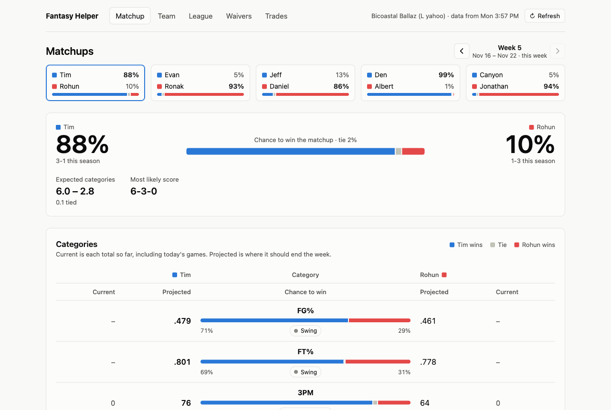
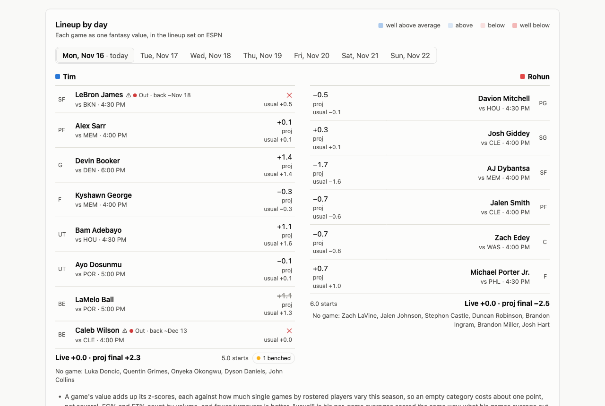
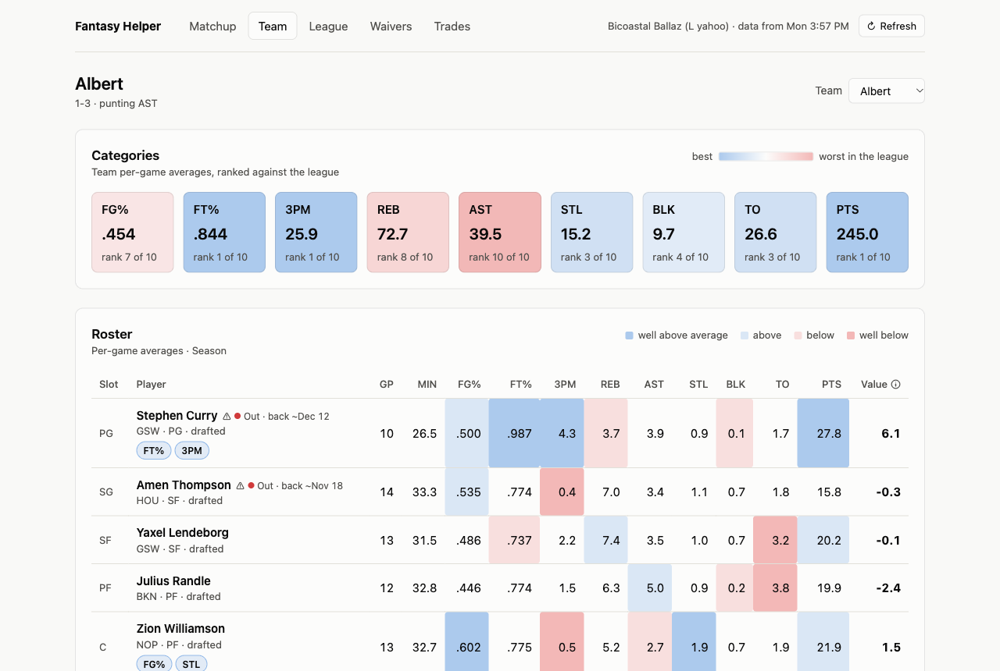
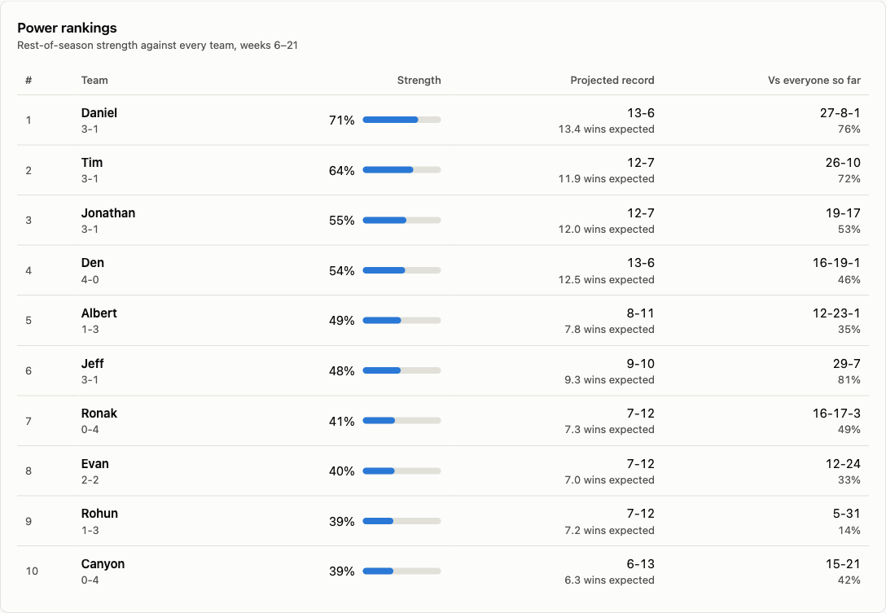
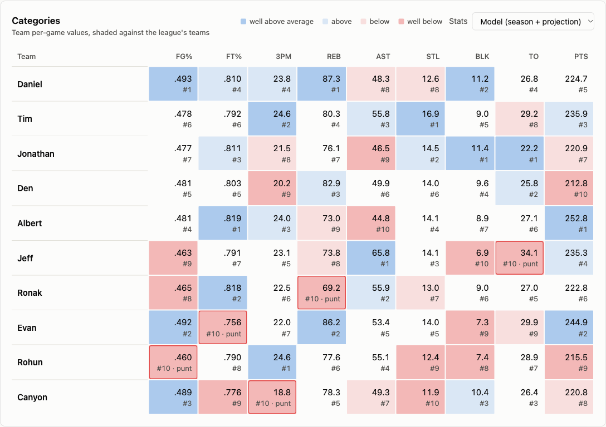
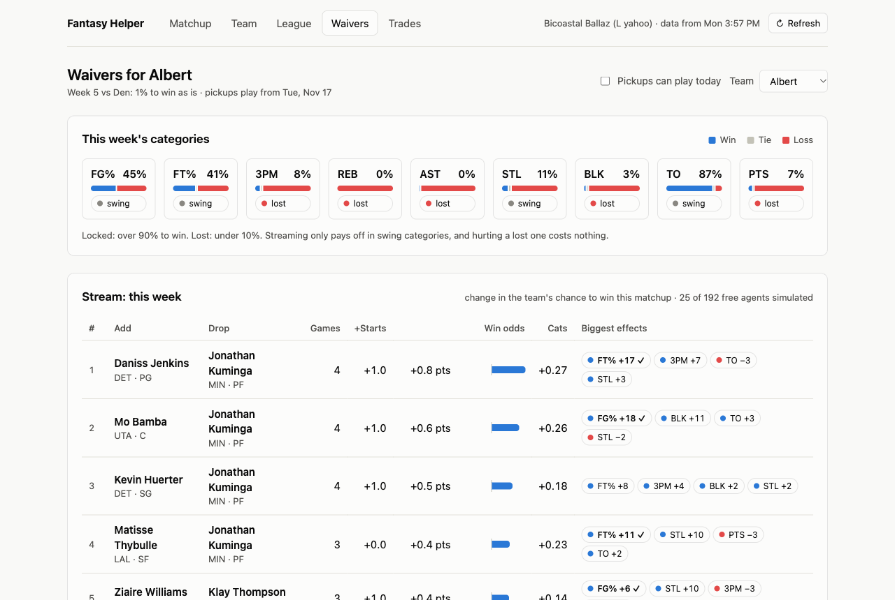
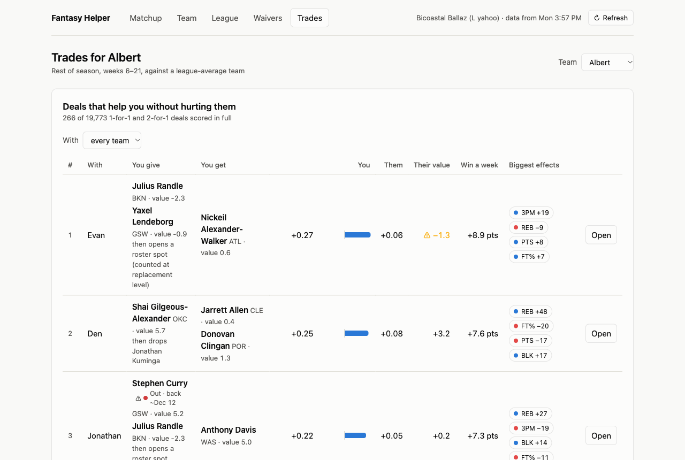
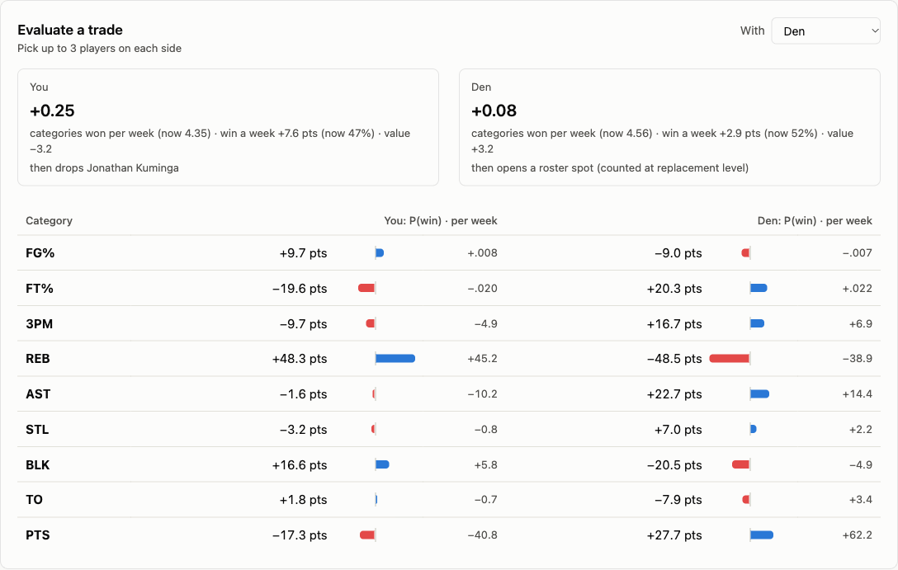
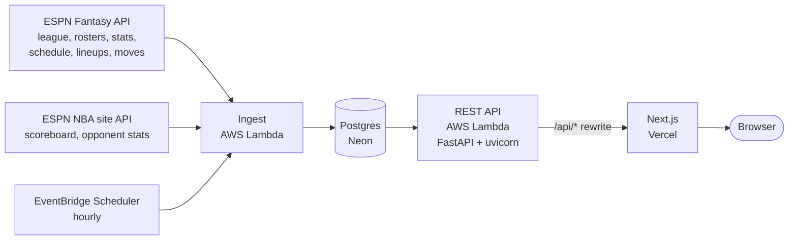
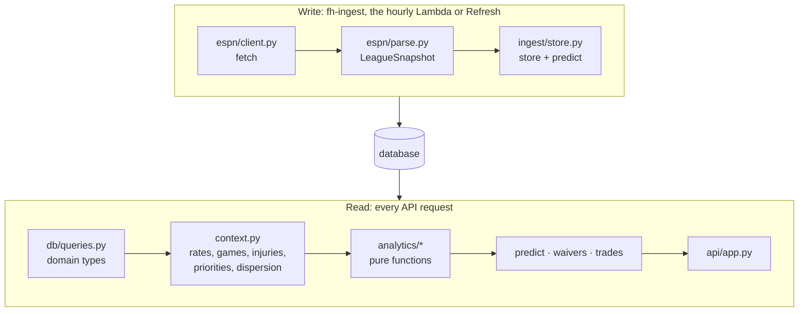

# Fantasy Helper

**Live win odds, waiver pickups and trade ideas for a 10-team, 9-category head-to-head ESPN NBA fantasy league.**

[](https://github.com/dwangman123/fantasy-helper/actions/workflows/ci.yml)
&nbsp;**[Open the live app →](https://fantasy-helper-umber.vercel.app)**

Fantasy Helper pulls the whole league from ESPN every hour, or on demand with Refresh, live during games. It simulates every matchup through the end of the week, and ranks pickups and trades by what they do for a team's categories and win odds. Every player is valued with **G-scores**, a variant of z-scores built for head-to-head play.



- [What it does](#what-it-does)
- [How players are valued: G-scores](#how-players-are-valued-g-scores)
- [The models behind the numbers](#the-models-behind-the-numbers)
- [Architecture](#architecture)
- [Data sources and caveats](#data-sources-and-caveats)
- [Repository layout](#repository-layout)

## What it does

The league scores **FG%, FT%, 3PM, REB, AST, STL, BLK, TO and PTS** head to head, most categories wins, with ties allowed. Each team starts 10 players a day. The app has five pages. Anyone in the league can look at any team, so no view assumes whose it is. A chat assistant that answers questions with the same numbers is in progress: its tools are built, the chat isn't yet.

### Matchup: who wins this week, and why

Every matchup in the week shows both teams' chance to win, expected categories and most likely score. Each category is shown head to head: the total so far (live during games), the projected final, and a win / tie / loss bar labelled *locked*, *swing* or *lost*. Below that is the lineup one day at a time. Past days are box scores, today shows live lines with the game clock, and later days are projections. Each game is one fantasy value, shaded against a typical game, and injured players are marked with their expected return. A chart tracks how both teams' odds moved after every ingest. Earlier weeks show ESPN's final results.



### Team: who's on a roster and what they're good at

Each player's per-game averages are shaded by z-score, and each player has a G-score value and *specialist* tags for the categories he's 1+ standard deviation above the rostered average in. The team's per-game category totals are ranked against the league, with punts inferred (more than 1.5 standard deviations below the league's teams), and the team's recent adds, drops and trades are listed. Any stat window can be picked: the model's blend, season, last 7 / 15 / 30 days, or ESPN's projection.



### League: who's actually good

Power rankings rate each team's rest-of-season strength by playing it against all nine others every remaining week (*all-play*). Next to that are a projected record, and how each team would have done against everyone in the weeks so far. A 10-team heatmap shows each category's per-game totals, ranks and punts.





### Waivers: who to pick up and who to drop

The page starts with a category board: each category of this week's matchup labelled locked, swing or lost. Below it, free agents are ranked for the selected team two ways:
- **Stream** re-runs this week's matchup with each free agent swapped in for one of the team's lowest-value players, and ranks them by the change in win odds.
- **Hold** ranks them by the change in expected categories won per week over the rest of the season.

Each pickup shows its best drop, the games it adds, and the categories it moves most.



### Trades: deals both sides should accept

The finder searches every 1-for-1 and 2-for-1 deal with every other team, and keeps the ones that help the selected team without hurting the partner. Each deal shows:
- both sides' change in categories won per week
- the change in the chance to win a week
- the partner's *value balance*, with lopsided deals flagged ⚠
- the forced roster moves: a drop to make room, or a spot opened

Any deal of up to three players a side can also be scored by hand.



<details>
<summary>A deal scored in full: Shai Gilgeous-Alexander for Jarrett Allen and Donovan Clingan</summary>



</details>

## How players are valued: G-scores

The usual fantasy value is a **z-score sum**: how far a player's per-game average is above the pool's, in standard deviations, added up over the nine categories. It treats every category alike. But a head-to-head week is a small sample, and in some categories a player's weekly numbers bounce a lot compared with how much players differ from each other. Steals bounce the most for their spread; rebounds and assists much less. So an edge in steals is more often luck in a given week. **G-scores** (Rosenof, [arXiv:2307.02188](https://arxiv.org/abs/2307.02188v5)) account for that. They add each category's week-to-week variance to the z-score's denominator. The paper shows that z-scores are the special case in which future performances are known exactly.

### The formula

For each category, a player's z-score is computed on **per-game averages against rostered players**, not the whole player pool: free agents would drag the mean down and inflate everyone's z.
- FG% and FT% are scored by volume as `makes − league% × attempts`, so a 60% shooter on 2 attempts is worth less than a 50% shooter on 20.
- TO is reversed, so higher is always better.

Each category's z is then weighted by

```
weight = 1 / √(1 + τ² / σ²)
```

- **σ²** is how much rostered players' averages differ in that category this season (the spread the z-score divides by).
- **τ²** is the *weekly bounce*: how much a typical player's per-game average moves from one week to the next.

The weights are scaled to average 1, and a player's value is the sum of his nine weighted z-scores ([`analytics/zscores.py`](backend/src/fantasy_helper/analytics/zscores.py)).

### Where the bounce comes from

`fh-fit-bounce` ([`fit_bounce.py`](backend/src/fantasy_helper/fit_bounce.py)) fits τ² once a season from last season's real weeks. The fit is checked in as [`weekly_bounce_2026.json`](backend/data/weekly_bounce_2026.json).
- **Players.** It ranks the 300 most-owned ESPN fantasy players of 2025-26 by z-sum. From those with at least 20 games, it keeps the top 130.
- **Weeks.** It pulls each player's game log from ESPN's public NBA API and splits it into Monday–Sunday weeks. Weeks where he played fewer than 3 games are dropped, since a short week is availability, not bounce. Each game is re-dated from that day's scoreboard, because the logs date games by UTC tip-off, which pushes most evening games a day late.
- **Bounce.** A category's τ² is the variance of a player's weekly per-game average, averaged over the pool. For counting stats it's scaled to this season's pool mean, since bounce grows with volume.

The resulting weights, on the 2026-11-16 snapshot (they follow this season's spread, so they drift a little):

| Category | STL | FG% | FT% | TO | BLK | 3PM | PTS | REB | AST |
|---|---|---|---|---|---|---|---|---|---|
| **Weight** | 0.76 | 0.81 | 0.86 | 0.96 | 1.03 | 1.10 | 1.12 | 1.17 | 1.18 |
| Rosenof, 2022-23 (rescaled to average 1) | 0.70 | 0.89 | 0.92 | 0.98 | 1.08 | 1.14 | 1.03 | 1.09 | 1.19 |

The four most discounted categories match Rosenof's Table 8 in the same order: steals, then the two percentages, then turnovers. Above those the order differs; for example, his data discounts points more. On the 2026-11-09 snapshot, switching from the plain z-sum reordered rostered players only modestly: rank correlation 0.984, with 9 of the top 10 unchanged. The biggest mover was Kris Dunn, from 77th to 102nd.

### Where the value is used

- **Start priority.** Who starts on a crowded day, for every team, in every simulation.
- **Drop candidates.** Which players Stream and Hold consider dropping.
- **The Team page.** The *Value* column and its sort order.
- **Trades.** The replacement level a player is never worth less than, and the value balance used to flag lopsided deals.

### What else was considered

The full comparison is in [`docs/research/9cat-player-valuation.md`](docs/research/9cat-player-valuation.md), with sources and the checks run on this league.
- **H-scoring** (Rosenof, [arXiv:2409.09884](https://arxiv.org/abs/2409.09884)) is a dynamic method built for drafting. Its in-season core already exists here: a normal approximation of category margins turned into win odds, which is what Hold does.
- **SGP** (standings gain points) is a rotisserie method.
- **Re-zeroing z-scores at replacement level**, with the player pool fixed, is a constant shift per category, so it can't reorder a z-sum.

Sources:
- Z. Rosenof, *Static quantification of player value for fantasy basketball*, [arXiv:2307.02188](https://arxiv.org/abs/2307.02188v5) (G-scores; Table 8 for the 2022-23 weights).
- Z. Rosenof, *Dynamic quantification of player value for fantasy basketball*, [arXiv:2409.09884](https://arxiv.org/abs/2409.09884) (H-scoring).
- The [Fantasy Basketball Optimizer](https://zer2.github.io/fantasy-basketball-optimizer/) docs, which implement G- and H-scores.

## The models behind the numbers

Each analytics module opens with a docstring explaining its method. The [backend README](backend/README.md#analytics) maps them.

**Per-game rates.** ESPN's projection is blended with the season so far, weighted by games played: `w = gp / (gp + 10)`. Ten games in, a player is half projection, half actual. Makes and attempts are blended separately, so percentages come out of the totals.

**Matchup odds.** A Monte Carlo of the rest of the week, on top of the totals so far:
- For each remaining day, each player with a game plays with his chance of playing; an injured player is out until ESPN's expected return date.
- The league's 10 starting slots are filled by G-score priority, since benched games don't count.
- A started game adds his per-game rate, adjusted for the NBA opponent: what that team allows per game against the league average, shrunk toward 1 early in the season.
- Team totals are drawn as Poisson or negative binomial, with each stat's dispersion fitted from this season's box scores. Makes are binomial given attempts.
- During games, a game that has tipped is locked into its slot, and only the rest of it is projected.

Comparisons share their random numbers (*common random numbers*). So when one player is swapped in, the change in odds measures the swap, not simulation noise.

**Stream** re-runs that simulation against the real opponent with each free agent swapped in, from the first day he can play. Because the measure is win odds against this opponent, help in a swing category counts, and help in a locked or lost one barely does. Weekly punts fall out without being coded.

**Hold** looks at the rest of the season instead: the change in expected categories won per week against a league-average team. Each week's totals respect the daily lineup cap and the real NBA schedule. Each category's odds are a normal approximation, with variance `φ × mean` for counting stats and `p(1 − p) / attempts` for percentages.

**Trades** use Hold's measure for both teams, plus the change in the chance to win a week. No player counts for less than a *replacement-level* player, the average of the top free agents by G-score. So a team can't gain by dumping a player it could cut anyway, and a negative-G throw-in can't make a lopsided deal look fair. To be listed, a deal must gain the selected team at least 0.05 categories a week and cost the partner nothing. The finder screens deals with a first-order estimate, then scores the most promising in full. On the 2026-11-16 snapshot, it screened 19,773 deals for one team and scored 266 of them in full.

**Power rankings** turn the same per-category odds into each team's expected share of wins against all nine others in every remaining week.

## Architecture



- **Ingest.** It pulls one consistent snapshot of the league from ESPN and cross-checks it, then stores it and appends the week's matchup predictions. Each run is logged with its warnings. The app's Refresh button runs the same job inside the API Lambda, and a Postgres advisory lock keeps it and the hourly run from overlapping. Both Lambdas read the database URL from Secrets Manager.
- **Analytics.** These are pure functions over ESPN-independent domain types, with no database or network access. So the same models run behind the API, the CLI tools and the tests.
- **API.** It serves each view from one team's side and caches simulations in memory per snapshot. On Lambda it runs as a web server (uvicorn) behind the [Lambda Web Adapter](https://github.com/awslabs/aws-lambda-web-adapter), so a response can stream as it's written. The frontend is a thin client: it only formats what the API returns.
- **Deploys.** The two Lambdas run two targets of one container image. GitHub Actions deploys after CI passes on `main`: the backend first (migrate, update both functions, smoke-test them, roll back if that fails), then the frontend. Terraform defines the AWS side. The whole thing is estimated at about $1 a month.

Inside the backend, data flows one way:



| Layer | Built with |
|---|---|
| **Backend** | Python 3.12, FastAPI, SQLAlchemy + Alembic, NumPy, SciPy, [espn-api](https://github.com/cwendt94/espn-api), uv, Ruff, pytest |
| **Frontend** | Next.js 16 (App Router), React 19, TanStack Query, plain CSS with light and dark themes |
| **Infrastructure** | AWS Lambda (container images on ECR, Lambda Web Adapter), EventBridge Scheduler, Secrets Manager, Neon Postgres, Vercel, Terraform, GitHub Actions |

## Data sources and caveats

- **ESPN's fantasy API** (via `espn-api`) supplies the league settings, rosters, set lineups, per-window stat lines, box scores, injuries, transactions and the NBA schedule by day. **ESPN's public NBA site API** supplies the live scoreboard, each NBA team's opponent stats, and last season's game logs. The site API is undocumented and can change without notice. A failed fetch keeps the last stored data and logs a warning.
- **Live totals come from box scores.** ESPN's matchup totals only count a day once it's processed. So "now" is summed from started games on completed days plus today's lines so far. Each ingest re-fetches the week's completed days to pick up stat corrections.
- **Percentages are never stored or averaged.** FG% and FT% always come from summed makes and attempts, so team totals are exact.
- **The matchup calendar is checked in.** ESPN's API doesn't expose matchup date ranges, and this season's weeks are irregular: a 6-day week 1, a 14-day All-Star week, and 2-week playoff rounds. [`backend/data/matchup_calendar_2027.json`](backend/data/matchup_calendar_2027.json) holds them, and every ingest cross-checks it against ESPN.
- **History is never wiped.** Box scores, adds and drops, and every run's matchup predictions are kept. They feed the odds charts and future backtests.
- **Without a signed-in session,** ESPN lists trades without their players. So trades are inferred from roster entries acquired by trade.

## Repository layout

```
backend/              Python package: ESPN ingest, database, analytics, REST API, Lambda entry points
  src/fantasy_helper/
    espn/             ESPN fetch and parsing into ESPN-independent domain types
    ingest/           fh-ingest: fetch, validate, store, predict
    db/               SQLAlchemy models and queries (SQLite locally, Postgres deployed)
    analytics/        pure model code: z/G-scores, rates, simulation, waivers, trades, power
    api/              FastAPI app
    agent/            the chat assistant: tools, name lookup, the model loop and POST /api/agent (in progress)
  data/               matchup calendar and the fitted weekly bounce
frontend/             Next.js app: Matchup, Team, League, Waivers and Trades pages
infra/terraform/      AWS infrastructure
docs/                 development and deploy guides, research notes, screenshots
```

**More documentation:**
- [backend/README.md](backend/README.md): the data flow, a module guide, the REST API, commands, settings, the database and tests.
- [frontend/README.md](frontend/README.md): how the app calls the API, the pages, URL state, components and conventions.
- [docs/development.md](docs/development.md): running it locally.
- [docs/deploy.md](docs/deploy.md): deploying it to AWS and Vercel.
- [docs/research/9cat-player-valuation.md](docs/research/9cat-player-valuation.md): the research behind G-scores.
- [PROJECT_PLAN.md](PROJECT_PLAN.md): the roadmap and the findings that changed it.
